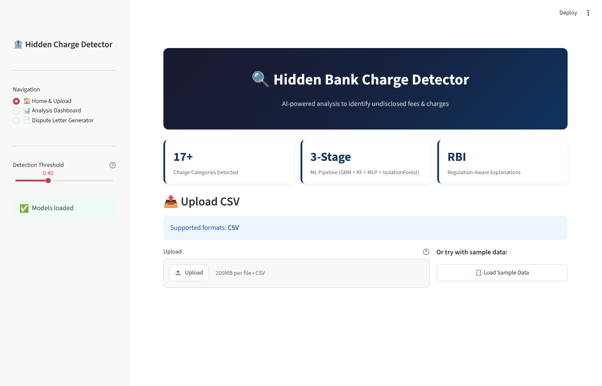
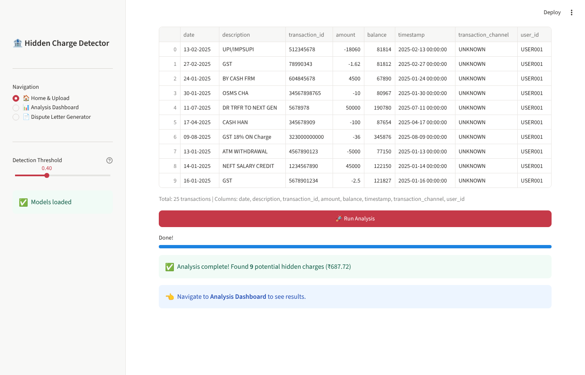
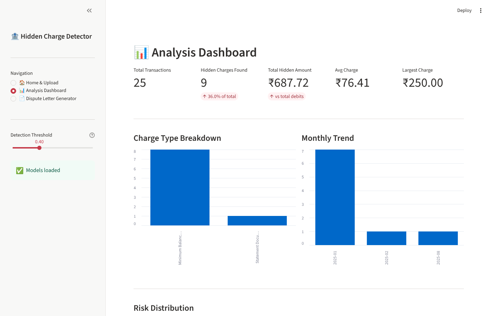
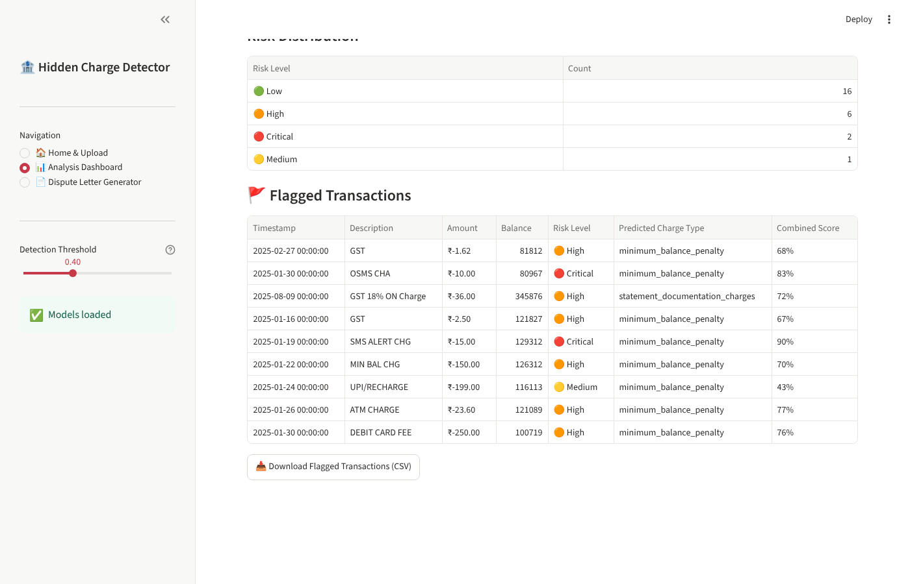
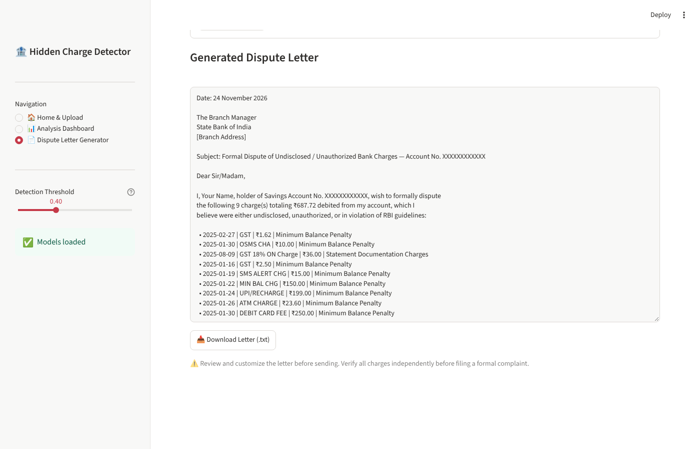
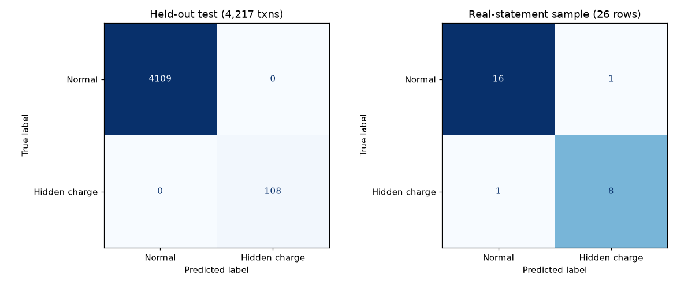
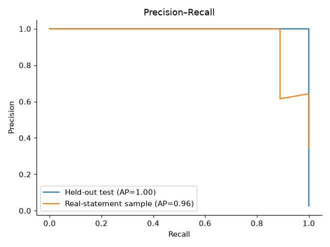

<h1 align="center">🔍 Hidden Bank Charge Detector</h1>

<p align="center">
  An ML system that scans bank statements and flags <b>hidden or undisclosed bank charges</b>,<br/>
  explains each one, and drafts a <b>dispute letter</b>.
</p>

<p align="center">
  
  
  
  
  
</p>

---

## 📌 Overview

An end-to-end machine learning system that analyses bank transactions
and identifies hidden or undisclosed bank charges, such as ATM fees, minimum-balance
penalties, forex markups, SMS alert fees and debit card annual charges.

---

## 📸 Screenshots

| Home & upload | Analysis complete |
|---|---|
|  |  |

| Analysis dashboard | Flagged transactions with risk level |
|---|---|
|  |  |

**Auto-generated dispute letter**



---

## 🏗️ Architecture

```
Transactions
        ↓
[Stage 1] Parser
     - CSV: auto-detect header, normalize columns
        ↓
[Stage 2] Feature Engineering (65+ features)
     - NLP: 17-category keyword matching, description patterns
     - Amount: debit flags, log-scale, rounding, small-amount signals
     - Temporal: hour, day, month, quarter-end, FY-end, RBI cycle awareness
     - Channel: UPI/NEFT/ATM/SYSTEM/ACH encoding
     - TxnID: pattern-based signals (SAL_, ATM_, T-prefix)
     - Statistical: user-level z-score, daily transaction count
        ↓
[Stage 3] SMOTE Oversampling (handles ~2.5% class imbalance)
        ↓
[Stage 4] Detection Ensemble (Soft Voting)
     - Calibrated GBM (weight=0.40) — 400 estimators, depth=5
     - Calibrated RF  (weight=0.35) — 300 estimators, balanced
     - Calibrated MLP (weight=0.25) — 256→128→64 ReLU
        ↓
[Stage 5] IsolationForest Anomaly Detector
     - Catches novel charges with no keyword signals
        ↓
[Combined Score] = 0.70 × detection_prob + 0.30 × anomaly_score
        ↓
[Stage 6] Multi-class Charge Type Classifier (GBM, 17 categories)
        ↓
[Stage 7] Explainability + RBI Regulation References
        ↓
[Stage 8] Dispute Letter Generator
```

---

## 🚀 Quick Start

### 1. Install dependencies
```bash
pip install -r requirements.txt
```
> `scikit-learn` is pinned to **1.8.0** because the saved models in `models/` were trained with it. Newer versions cannot load them.

### 2. Train models (first time only; pre-trained models are already included)
```bash
python train_model.py --data data/bank_transactions.csv
```

### 3. Launch the app
```bash
streamlit run app.py
```

### 4. Run tests and evaluation
```bash
pip install pytest && pytest -v
python evaluate.py          # held-out test + real-statement check → docs/evaluation/
```

---

## 📂 Project Structure

```
hidden_charge_detector/
├── app.py                        # Main Streamlit UI
├── train_model.py                # Training entry point
├── evaluate.py                   # Held-out + real-statement evaluation
├── tests/test_detector.py        # 14 automated test cases
├── docs/                         # Screenshots, evaluation plots, metrics
├── requirements.txt
├── README.md
├── data/
│   └── bank_transactions.csv     # Training dataset (put your data here)
├── models/                       # Saved model artifacts (auto-created)
│   ├── scaler.pkl
│   ├── ensemble.pkl
│   ├── iso_scaler.pkl
│   ├── iso_model.pkl
│   ├── type_clf.pkl
│   ├── feature_cols.pkl
│   ├── charge_types.pkl
│   └── metrics.pkl
└── src/
    ├── __init__.py
    ├── feature_engineering.py    # 65+ feature extractors
    ├── model.py                   # ML pipeline: train + predict
    ├── parser.py         # CSV/PDF parser
    └── explainability.py          # Explanations + dispute letter
```


---

## 🔍 Detected Charge Categories (17)

| Category | Description |
|----------|-------------|
| `atm_usage_charges` | ATM withdrawal/decline fees |
| `forex_markup_charges` | International transaction markup |
| `minimum_balance_penalty` | AQB non-maintenance penalty |
| `account_maintenance_charges` | Annual maintenance charges |
| `sms_alert_charges` | SMS transaction alert fees |
| `debit_card_annual_charges` | Annual/renewal debit card fee |
| `debit_card_replacement_charges` | Card reissuance fee |
| `cheque_book_charges` | Cheque book issuance fee |
| `cheque_bounce_charges` | Cheque/NACH return charges |
| `locker_charges` | Safe deposit locker rent |
| `fund_transfer_charges` | NEFT/RTGS/IMPS service fee |
| `cash_handling_charges` | Cash deposit/withdrawal fee |
| `dormant_account_charges` | Inoperative account penalty |
| `account_closure_charges` | Pre-closure fee |
| `overdraft_insufficient_balance` | OD penalty/interest |
| `statement_documentation_charges` | Physical statement fee |

---

## ✅ Test case scenarios

Run with `pytest -v`.

| # | Scenario | Expected result | Status |
|---|---|---|---|
| TC01 | Bank-style headers (`Txn Date, Narration, Ref No, Withdrawal, Deposit`) | Columns normalised; debit/credit merged into a signed amount | ✅ Pass |
| TC02 | Statement with a bank preamble above the header row | Header row detected automatically | ✅ Pass |
| TC03 | Indian dates `13-02-2025` | Parsed as day-first (13 Feb) | ✅ Pass |
| TC04 | Unsupported file type | Clear `ValueError` | ✅ Pass |
| TC05 | ATM / SMS / min-balance / NACH-return charges | All flagged | ✅ Pass |
| TC06 | Salary, UPI and POS spends | Not flagged | ✅ Pass |
| TC07 | Charge-type classification | `sms_alert_charges`, `minimum_balance_penalty`, `none` | ✅ Pass |
| TC08 | Numeric transaction IDs | Works (crashed before the fix) | ✅ Pass |
| TC09 | Threshold 0.30 vs 0.70 | Lower threshold flags at least as many | ✅ Pass |
| TC10 | Scores and risk levels | Scores in [0, 1]; valid risk labels | ✅ Pass |
| TC11 | Explainability | An explanation is produced per flagged row | ✅ Pass |
| TC12 | Dashboard summary | Totals equal the sum of flagged amounts | ✅ Pass |
| TC13 | Dispute letter | Includes bank, holder name and the charges | ✅ Pass |
| TC14 | Monthly trend | Populated per month (was always empty before the fix) | ✅ Pass |

Full output: [`docs/test_results.txt`](docs/test_results.txt).

## 📊 Evaluation

The metrics saved by `train_model.py` (all 1.00) are measured on the **training data**, and the cross-validation there runs **after** SMOTE oversampling. Both overstate real performance. `evaluate.py` measures the system more honestly in two ways.

### 1. Held-out test (synthetic dataset)

The full pipeline is retrained on a stratified 80% (16,866 transactions) and scored on the untouched 20% (4,217 transactions, 108 hidden charges).

| Accuracy | Precision | Recall | F1 | ROC-AUC | PR-AUC | Charge-type accuracy |
|---|---|---|---|---|---|---|
| 1.000 | 1.000 | 1.000 | 1.000 | 1.000 | 1.000 | **0.861** |

Detection is perfect because, in the synthetic dataset, every hidden charge follows a keyword or ID pattern the features capture directly (`ADJ`, `CHRG`, `SYSTEM` channel). The harder task is telling the **17 charge types** apart, which reaches 86%.

### 2. Real-statement check (generalisation)

The shipped models were run on **26 hand-labelled rows from a real-format passbook**, with wording the model never saw in training (`OSMS CHA`, `CASH HAN`, `GST 18% ON Charge`).

| Accuracy | Precision | Recall | F1 | ROC-AUC | PR-AUC |
|---|---|---|---|---|---|
| **0.923** | **0.889** | **0.889** | **0.889** | 0.967 | 0.960 |

| Confusion matrices | Precision–recall |
|---|---|
|  |  |

- **8 of 9** real hidden charges were caught. 
- Inference takes about **0.1 ms per transaction**.

All numbers are in [`docs/evaluation/metrics.json`](docs/evaluation/metrics.json).

---
